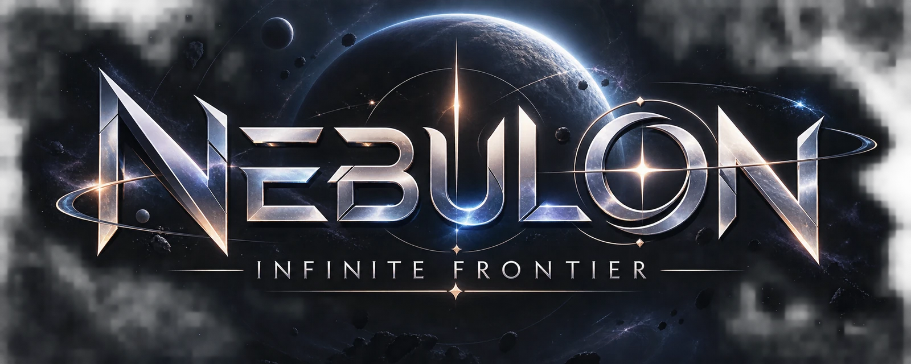
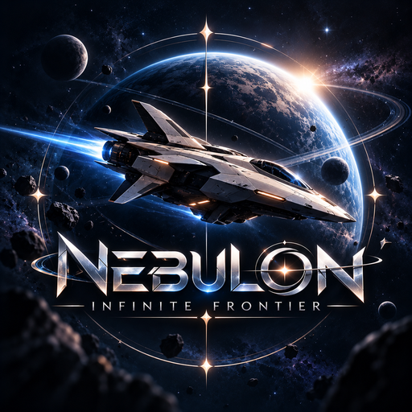

<div align="center">


<br />

**A 3D endless space-flight game that runs entirely in your browser.**
Dodge the debris, bank the energy, and cross wormholes into the unknown.

<br />

[](https://nebulon-frontier.vercel.app/)
[](LICENSE)
[](#-install-and-offline-play)


</div>

<br />

<div align="center">
  
</div>

## ✨ About

Nebulon is a space-flight game with no backend and no account. You pilot a ship through an endless field of asteroids, wrecks, comets and energy anomalies, collect energy to build your score, and push the hyperdrive when you need distance. One hit ends a run, so the game rewards reading the field early and moving smoothly.

Every so often a wormhole opens ahead. Fly through it and you arrive in a different universe, chosen at random. Each universe has its own sky, lighting and hazards, and eight of them are realms with mechanics of their own.

## 🎮 Features

- **Three missions**: Classic, Survival and Hyperdrive.
- **24 universes** with their own skies, hazards and star fields. Wormholes always lead somewhere new, drawn from a shuffle bag so a long run keeps changing.
- **Eight realms**: The Crystal Universe, The Fractured Timeline, The Living Universe, The Black Hole Universe, The Ocean of Stars, The Frozen Universe, The Chaos Universe and The Corrupted Universe.
- **A hangar of ships**, a codex of rare discoveries, and personal records saved on your device.
- **Procedural audio**: engine and effects are synthesised with the Web Audio API.
- **Installable and offline**: the whole game, music included, works with no connection.
- **Desktop, phone and tablet**: keyboard, mouse and touch controls, with an optional first-person cockpit view.

## 🕹️ Controls

| Input | Action |
| --- | --- |
| `W` `A` `S` `D` or arrow keys | Steer |
| `Space` | Hyperdrive |
| `Esc` | Pause |
| Drag (touch or mouse) | Steer |
| On-screen button (touch) | Hyperdrive |

The game pauses by itself when the tab is hidden.

## 📲 Install and offline play

Nebulon is a progressive web app. Install it from your browser, or from Settings, and the game, its fonts, images and music are stored on your device. On iPhone and iPad, tap Share, then Add to Home Screen. After the first online visit you can play with no connection.

## 🧰 Tech stack

| Technology | Used for |
| --- | --- |
| [Nuxt 3](https://nuxt.com) | Single-page app shell, tooling and static generation |
| [Vue 3](https://vuejs.org) | Menus, HUD and settings |
| [TypeScript](https://www.typescriptlang.org) | Strict typing across engine, interface and saves |
| [Three.js](https://threejs.org) | WebGL rendering and custom GLSL shaders |
| [Web Audio API](https://developer.mozilla.org/docs/Web/API/Web_Audio_API) | Live-synthesised engine and effects |
| Service worker and web manifest | Installable app with full offline play |
| [anime.js](https://animejs.com) | Interface motion |
| [Lucide](https://lucide.dev) | Icons |
| [Fontsource](https://fontsource.org) | Orbitron, Exo 2 and Share Tech Mono, bundled |
| [Vercel](https://vercel.com) | Hosting |

## 🚀 Getting started

```bash
git clone https://github.com/Itz-Murali/Nebulon.git
cd Nebulon
npm install
npm run dev
```

| Command | What it does |
| --- | --- |
| `npm run dev` | Start the dev server |
| `npm run build` | Production build |
| `npm run generate` | Static build for hosting (output in `.output/public`) |
| `npm run preview` | Preview the production build |

The service worker is only registered on non-localhost hosts, so test offline play on a deployed build.

## 🗂️ Project structure

```text
app.vue            root: routing between the game and the full-page screens
components/        menus, HUD, settings, About, Terms and License pages
composables/       game state, save data, PWA install, motion and routing helpers
data/site.ts       copy for the About, Terms and License pages
game/              engine, universes, realms, shaders, audio and music
assets/css/        styles
public/            icons, brand images, music, manifest and service worker
```

## 🌐 Deploying

Deploy to [Vercel](https://vercel.com) with build command `npm run generate` and output directory `.output/public` (already set in `vercel.json`, which also rewrites every path to the app so `/about`, `/terms` and `/license` work on refresh).

Set `SITE_URL` (for example `https://nebulon-frontier.vercel.app`) so link-preview images use absolute URLs. If it is not set, the production URL above is used.

## 🎵 Music

The soundtrack is **Sky High** by **Elektronomia**, bundled at `public/audio/nebulon-theme.mp3` so it plays offline. It belongs to its artist.

## 📜 License

Nebulon is open source under the **Nebulon Attribution License**: you may use, copy, modify, merge, publish, distribute, sublicense and sell the software, as long as you give clear credit to both creators, keep the license text, and do not claim to be the original author. Read the full text in [LICENSE](LICENSE).

<p align="center">
  
</p>

